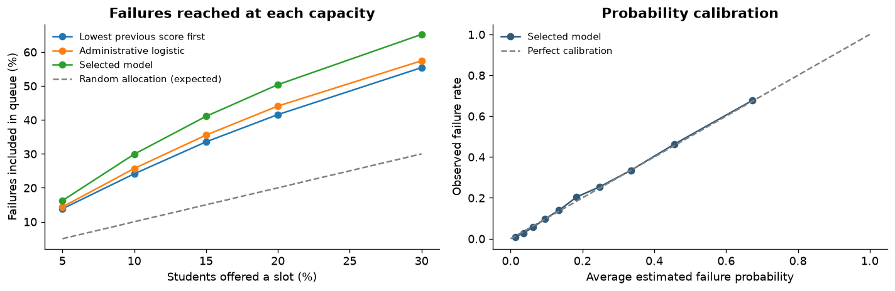

# Student Support Queue

A data science project by **Sitt Min Thar** that helps teachers prioritize limited support before an exam.

**[Live project showcase](https://smttheSE.github.io/student-support-queue/)** · **[Executed notebook](outputs/student_support/student_support_queue.ipynb)** · **[Computed findings](outputs/student_support/RESULTS.md)**



## The problem and the product

An exam result can reveal a learning gap after the opportunity for early support has passed. Teachers need a manageable worklist before the exam, especially when staff time and tutoring slots are limited.

Student Support Queue ranks a frozen pre-exam cohort by estimated failure risk. A teacher checks learning gaps and agrees on accessible support with the student. The product produces a priority rank, estimated probability, missing-input count, recorded support needs, and an offered-slot flag. Students retain access to teacher referrals and ordinary support.

The target is an exam score below 50, which matches the supplied file's pass/fail labels. This is not a dropout prediction or a diagnosis.

## Measured results

The supplied file contains 100,000 records and 44 fields. Model selection used separate data, with a fixed capacity of 10%. The final test contains 20,000 records.

| Allocation policy | Support slots | Students who failed, reached | Queue precision | Recall among failures |
| --- | ---: | ---: | ---: | ---: |
| Lowest previous score first | 2,000 | 1,091 | 54.6% | 24.1% |
| Administrative baseline | 2,000 | 1,162 | 58.1% | 25.7% |
| Student Support Queue | 2,000 | 1,353 | 67.7% | 29.9% |
| Random allocation, expected | 2,000 | 452.2 | 22.6% | 10.0% |

The selected model reaches **191 additional students who failed** using the same number of slots as the administrative baseline, a **16.4% increase in reach**. Its record-bootstrap precision interval is 65.7%–69.7% at 95% confidence. There are still 3,169 failures outside the queue at this capacity.

The chosen model is calibrated logistic regression. Final-test ROC AUC is 0.818 and Brier score is 0.1329. These figures measure offline targeting and probability quality. No prevented failures or financial savings were observed in this dataset.

## Analysis and validation

- Raw-data audit, unique-ID checks, outcome reconciliation, and a dictionary for every field.
- Current-exam answers and outcome labels excluded from scoring; feature timing requirements documented.
- Training, calibration, selection, and test splits of 60%, 10%, 10%, and 20%.
- Previous-score, administrative, richer logistic, and gradient-boosting model comparisons.
- Fixed-capacity evaluation, uncertainty intervals, feature importance, and staffing sensitivity.
- Group error and access audits, including income, gender, location, and education level.
- Explicit business scenarios separating measured reach from assumed program impact.
- Executed notebook and scoring checks for invalid inputs, missing values, slot limits, outcome exclusion, order invariance, and CSV output preservation.

See [verification results](outputs/student_support/verification.json) and [aggregate evidence](outputs/student_support).

## Reproduce the analysis

The original student CSV is deliberately excluded from this public repository. Its provenance, collection times, and publication license were not supplied. Use an authorized copy named `student_exam_performance.csv` in the project root, or attach that file to the notebook in Kaggle. The original file's SHA-256 fingerprint is recorded in [run metadata](outputs/student_support/results_summary.json).

For Kaggle, import the [notebook](outputs/student_support/student_support_queue.ipynb), attach the authorized CSV as an input, and run on CPU. No internet or additional project scripts are required. Individual queue exports remain disabled by default.

For local reproduction:

```bash
python3 -m venv .venv
source .venv/bin/activate
python -m pip install -r requirements.txt
python -m ipykernel install --prefix .venv --name python3
python build_notebook.py
JUPYTER_PATH="$PWD/.venv/share/jupyter" python execute_notebook.py
python verify_product.py
```

To score an authorized unlabeled cohort:

```bash
python outputs/student_support/score_students.py \
  --input pre_exam_snapshot.csv \
  --slots 25 \
  --output teacher_worklist.csv
```

Use the [blank input template](outputs/student_support/scoring_input_template.csv). The saved model requires compatible package versions; rebuild it in a different runtime. Load only trusted model artifacts.

## Showcase website

The buildless website lives in `docs/` and is published by GitHub Pages from `main:/docs`. It includes an interactive explorer backed by aggregate heldout results, direct notebook downloads, the product workflow, and a business scenario with explicit assumptions.

The presentation takes inspiration from Anthropic's warm editorial website: cream backgrounds, bold sans-serif headlines, serif reading text, rounded panels, and restrained navigation. Inter and Source Serif 4 are hosted locally under the SIL Open Font License; licenses are included in `docs/assets/fonts/`. The site retains its own project identity.

Preview locally:

```bash
python -m http.server 8000 --directory docs
```

The website runs entirely in the browser. It does not collect or score individual student records.

## Evidence boundaries and the next decision

Source provenance and pre-exam availability are unverified. The file has no school IDs, exam dates, subjects, or randomized intervention outcomes. Random holdout performance describes these records, not future schools or exams. Excluding demographic inputs does not by itself establish fairness.

A school pilot must confirm the data contract, test the queue on later exams, audit contact and participation, and evaluate actual support outcomes. The notebook describes separate evaluations of intervention effectiveness and allocation-policy effectiveness.

The workflow is informed by [IES guidance on monitoring and individualized support](https://ies.ed.gov/ncee/wwc/PracticeGuide/24) and [EEF evidence on targeted tuition](https://educationendowmentfoundation.org.uk/education-evidence/teaching-learning-toolkit/one-to-one-tuition). Their evidence motivates a pilot; it is not a measured effect of this model.
